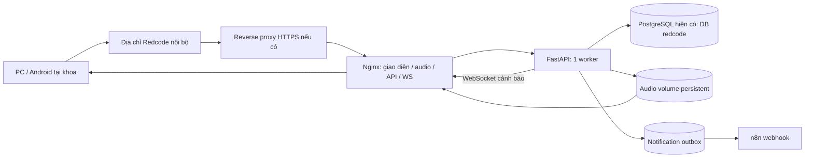
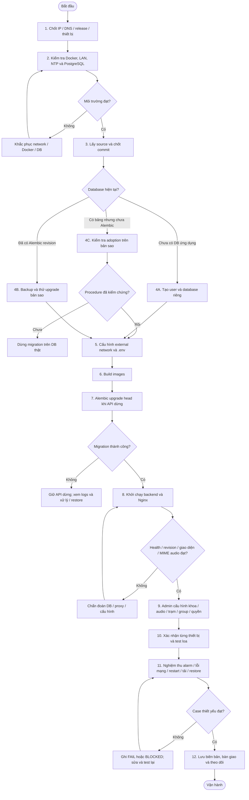
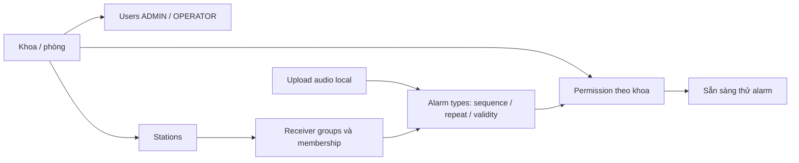
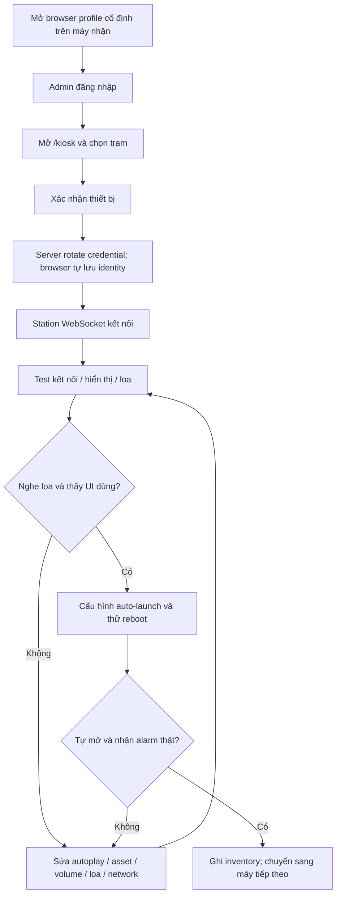
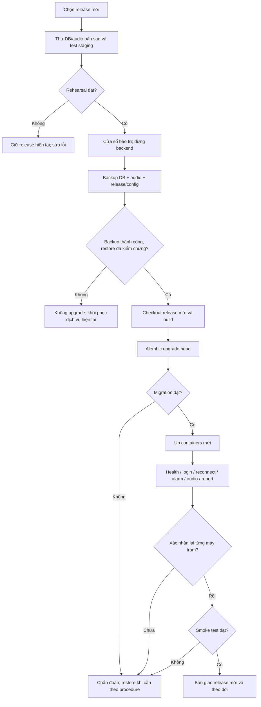
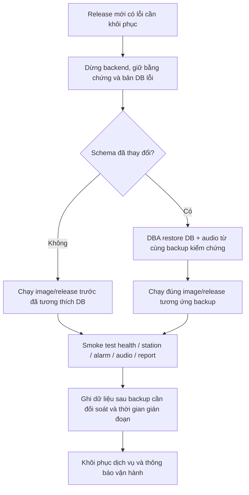

# REDCODE — Sơ đồ triển khai production từng bước

Tài liệu dành cho người trực tiếp triển khai tại bệnh viện. Tham chiếu code `84ad2d6`, migration head `20261007_integrations`.

- **Đọc sơ đồ và làm theo thứ tự trong tài liệu này.**
- Lệnh backup/restore, bảng biến `.env` đầy đủ và bằng chứng nghiệm thu: [Runbook production](production_deployment.md).
- Các bài nghiệm thu và mẫu biên bản: [Hướng dẫn kiểm thử](testing_guide.md).
- Các lệnh sử dụng **Bash trên Linux**, tại root repository trừ khi ghi khác. `<...>` là thông tin phải thay theo server thực tế.

## 0. Ba điều phải biết trước khi bắt đầu

**Cấu hình chỉ bằng `.env`.** IT chuẩn bị PostgreSQL/network/user trước, rồi khai báo `DATABASE_URL` (và `N8N_ENABLED`/`N8N_WEBHOOK_URL` nếu dùng n8n) trong `.env`. URL n8n mặc định là `http://n8n:5678/webhook/redcode`: hostname `n8n` chỉ phân giải được khi backend cùng Docker network với container n8n, và path phải khớp path của Webhook node trong workflow n8n. Container launcher chạy `alembic upgrade head` rồi khởi động API; thiếu `DATABASE_URL` ở production thì dừng ngay lúc khởi động. Không còn wizard thiết lập database, không còn `/admin/settings` cho n8n.

**Trạng thái trạm nay chỉ nói điều chứng minh được.** Một trạm chỉ `ONLINE`/`AUDIO READY` khi có kênh WebSocket thật. Sau khi khởi động lại máy chủ, toàn bộ cờ cũ bị xóa và mọi trạm hiện `OFFLINE` cho tới khi kết nối lại — đây là hành vi đúng. Trong cửa sổ triển khai/upgrade phải có người xác nhận từng máy trở lại ONLINE.

**Hai con số thay cho một lời khẳng định.** Phản hồi phát báo động có `target_station_count` (số trạm đích) và `delivered_station_count` (số trạm gửi thành công). Nghiệm thu phải đối chiếu cả hai; `delivered < target` là có trạm chưa nhận, không phải "đã phát xong".

## 1. Nhìn nhanh: đường đi của hệ thống



**Hiểu đơn giản:** người dùng chỉ mở địa chỉ Redcode; Nginx đưa giao diện và âm thanh tới browser, FastAPI xử lý nghiệp vụ, PostgreSQL giữ dữ liệu. n8n nhận thông báo qua outbox, không quyết định việc phát alarm.

Nếu dùng HTTP LAN trực tiếp, browser vào Nginx port 80, bỏ bước reverse proxy HTTPS. Compose hiện chưa có TLS; HTTPS phải được cấu hình ở lớp deployment.

## 2. Sơ đồ tổng thể: từ chuẩn bị đến vận hành



Nếu công cụ không hiển thị Mermaid, đọc theo chuỗi: **Chuẩn bị → DB → Cấu hình → Build → Migration → Startup → Nghiệp vụ → Thiết bị → Nghiệm thu → Bàn giao**.

## 3. Phiếu thông tin trước khi thao tác

Điền các giá trị này một lần, dùng nhất quán trong mọi bước:

| Thông tin | Giá trị tại bệnh viện |
|---|---|
| Release commit được chọn | `<commit>` |
| IP server / DNS Redcode | `<ip>` / `<dns>` |
| Origin browser truy cập | `http://<ip>` hoặc `https://<dns>` |
| PostgreSQL container/host | `<pg-container>` / `<pg-alias>` |
| External Docker network | `<pg-network>` |
| Database / application user | `redcode` / `<app-user>` |
| n8n URL hoặc tắt integration | `<url>` / để trống |
| Backup directory / kho secrets | `<backup-location>` |
| Máy thử đầu tiên | `<station-code>` / `<model-browser-loa>` |
| Người phụ trách DB / LAN / vận hành | `<names>` |

## 4. Các bước triển khai chi tiết

### Bước 1 — Chốt phạm vi và cửa sổ triển khai

**Thực hiện:** chọn release, địa chỉ truy cập, khoa/nhóm thử, danh sách trạm và người phụ trách. Nếu nâng cấp hệ thống đang dùng, chọn cửa sổ bảo trì, thông báo quy trình liên lạc thay thế, và bố trí người xác nhận từng máy trạm kết nối lại (xem mục 0).

**Kết quả cần có:** phiếu mục 3 đã điền, lịch triển khai và release xác định. Ghi rõ đây là fresh install hay upgrade.

### Bước 2 — Kiểm tra server, LAN và PostgreSQL

```bash
docker info
docker compose version
timedatectl status
docker network inspect <pg-network>
```

**Kiểm tra:** Docker server hoạt động; đồng hồ đồng bộ; backend sẽ truy cập được PostgreSQL alias qua network; PC/Android truy cập được server qua VLAN. Chuẩn bị disk, UPS, persistent DB/audio và nơi backup.

**Điều kiện qua bước:** Docker/network/DB sẵn sàng. Nếu Docker daemon không chạy hoặc DB không reachable, xử lý trước; build thành công không sửa được lỗi network.

### Bước 3 — Lấy source đúng release

```bash
git clone https://github.com/buinguyenhong/REDCODETHIENHANH.git
cd REDCODETHIENHANH
git checkout <release-commit>
git rev-parse HEAD
```

Nếu đã có checkout, kiểm tra `git status` trước khi đổi release để bảo toàn cấu hình deployment tại server. Máy offline dùng source/images được chuẩn bị từ môi trường build.

**Kết quả cần có:** hash release được ghi vào biên bản; source đầy đủ backend/frontend/nginx/migrations.

### Bước 4 — Chọn đúng đường database

| Tình trạng | Thao tác |
|---|---|
| Fresh install, chưa có DB Redcode | DBA tạo user + DB riêng trên PostgreSQL hiện có; xem SQL tại runbook mục 3 |
| DB Redcode đã quản lý bằng Alembic | Backup DB/audio; thử nâng cấp bản sao; dừng API khi migrate thật |
| DB có bảng từ create_all, chưa alembic_version | Inventory schema và chốt adoption procedure trên bản sao; không chạy initial create-tables, không stamp head tùy tiện |

**Điều kiện qua bước:** có DB đích đúng, credentials được lưu bảo mật, backup/procedure phù hợp tình trạng DB. Không tạo lại PostgreSQL production container.

### Bước 5 — Cấu hình network, origin và secrets

1. Trong `docker-compose.yml`, gắn backend vào external PostgreSQL network, khai báo đúng tên network như runbook mục 3.2.
2. Tạo `.env`:

```bash
cp .env.example .env
chmod 600 .env
```

3. Điền đủ các biến theo bảng trong runbook mục 4: `ENVIRONMENT=production`, `DEMO_MODE=false`, `DATABASE_URL` PostgreSQL, `SECRET_KEY` riêng ≥32 ký tự, origin cụ thể, và `INITIAL_ADMIN_PASSWORD` cho lần bootstrap đầu.
4. `DATABASE_URL` dùng **PostgreSQL alias**, không localhost của backend; URL-encode password.
5. Nếu dùng HTTPS: cấu hình TLS/proxy `/ws` Upgrade và bảo vệ query credentials trong logs ở mọi proxy.

**Điều kiện qua bước:** `.env` không có credentials mẫu, origin khớp browser; external network tồn tại. Không lưu output chứa secret trong evidence. Cấu hình sai sẽ bị `app/config.py` chặn lúc khởi động với thông báo rõ ràng — đó là kết quả đúng, không phải lỗi cần vượt qua.

### Bước 6 — Validate cấu hình và build images

```bash
docker compose config --quiet
docker compose build
```

**Kết quả cần có:** cả backend và Nginx image build thành công; frontend được build trong Nginx image. Nếu thiếu package/registry ở môi trường offline, dùng images đã chuẩn bị và kiểm tra đúng release.

### Bước 7 — Chạy migration trước mở dịch vụ

Với upgrade, chỉ thực hiện sau backup/upgrade rehearsal:

```bash
docker compose stop backend
docker compose run --rm --no-deps backend alembic upgrade head
```

**Kết quả cần có:** upgrade PASS đến revision release. Với release tham chiếu, `alembic current` trả **`20261007_integrations (head)`**; chuỗi đầy đủ trên DB trắng là `8280022f67e9 → 20261006_runtime → 20261006_validity → 20261007_permissions → 20261007_integrations`. Giữ DB/history, normalized permission và legacy import đúng.

**Nếu FAIL:** giữ backend dừng, ghi lỗi migration, kiểm tra quyền/alias/schema. Xem nhánh phục hồi mục 7. Không dùng create_all/downgrade giả để vượt lỗi.

### Bước 8 — Khởi chạy và kiểm tra entrypoint

```bash
docker compose up -d
docker compose ps
docker compose exec -T backend alembic current
docker compose exec -T nginx nginx -t
curl --fail --silent --show-error http://127.0.0.1/api/health
curl -sI http://127.0.0.1/assets/audio/<ten-tep-coi>.wav | grep -i content-type
docker compose logs --tail=100 backend nginx
```

Lệnh curl trên giả định Compose port 80 mặc định; nếu port/entrypoint đã đổi, dùng URL thực. Mở origin từ máy ở khoa và kiểm tra `/login`, `/kiosk`, local audio và WS.

**Điều kiện qua bước:**

- containers chạy, revision đúng `20261007_integrations`;
- JSON health có `database: "ok"` **và** `websocket: "ok"`. `websocket: "degraded"` nghĩa là vòng giám sát nhịp tim **đã bật rồi chết** — `status` cũng thành `degraded`, không trạm nào được đánh offline nữa và báo động hết hạn không được kết thúc; dừng lại và xem log. `websocket: "not_started"` nghĩa là chưa chạy tới bước bật monitor — bình thường vài giây đầu, đứng yên thì là lỗi;
- log backend có `Station offline monitor active` và `Durable notification outbox worker active`;
- audio trả `Content-Type: audio/wav` (không phải `application/octet-stream`) — sai kiểu media thì loa không kêu dù UI hiện báo động;
- giao diện qua Nginx mở được.

n8n degraded được ghi riêng; không chặn core. HTTP 200 đơn thuần chưa chứng minh schema/loa/routing hoạt động.

### Bước 9 — Cấu hình nghiệp vụ theo thứ tự



1. Admin login → `/admin`; fresh production chỉ có Admin bootstrap (tạo từ `INITIAL_ADMIN_PASSWORD`, thiếu biến này thì tiến trình seed dừng có chủ ý).
2. Tạo khoa và users.
3. Tạo stations, groups và đúng membership; thiếu UI thao tác thì dùng API đã có trong `/api/docs`.
4. Upload audio, mở URL kiểm tra (HTTP 200 **và** `Content-Type` đúng); file nhỏ hơn limit 20M kể cả multipart.
5. Cấu hình alarm types và quyền khoa. **Mỗi alarm type phải có ít nhất một tệp âm thanh** — `audio_sequence` rỗng bị từ chối 422. Kiểm tra group-in/out; type không group nhận toàn bộ stations enabled.
6. Chốt validity/repeat/interval với người vận hành; không dùng fixture ngắn của test làm mặc định production ngoài ý muốn.

**Kết quả cần có:** bảng mapping khoa → quyền alarm → nhóm → stations → audio được người vận hành xác nhận.

### Bước 10 — Xác nhận từng máy nhận



**Thực hiện trên máy nhận, không chỉ từ máy Admin:** chọn đúng station → xác nhận → logout Admin nếu chạy receiver độc lập → giữ nguyên profile/origin → launcher mở `/kiosk`.

**Kết quả cần có cho từng máy:** ONLINE, RTT có phản hồi, overlay test đúng, loa nghe thực, boot/refresh giữ identity. Xác nhận lại làm credential cũ bị thu hồi (đóng `1008` kèm lý do). READY trên browser không chứng minh loa không mute/rút dây.

**Khi sửa cấu hình một trạm đang trực:** đổi tên/vị trí/nhóm nhận không ngắt thiết bị; đổi token hoặc mã trạm sẽ ngắt và buộc xác nhận lại tại chỗ. Đừng xóa profile/localStorage để "thử lại" — làm vậy mất credential.

### Bước 11 — Nghiệm thu trước bàn giao

Thực hiện T01–T13 trong [testing guide](testing_guide.md), tối thiểu:

1. Operator có quyền trigger; khoa không có quyền bị deny.
2. S1/S2 trong group nhận; S3 ngoài group không nhận.
3. Local dismiss S1 không tắt S2/global.
4. Global cancel/expire dừng đúng targets; giữ audit, không n8n end.
5. Mất mạng → missed ACTIVE sync; không replay cancelled/expired/dismissed.
6. Audio failure/retry và PC/Android unattended thật.
7. n8n down/core vẫn alarm; outbox retry/crash recovery.
8. Server/DB/container restart, tải real sockets qua entrypoint staging và backup restore drill.

Ba điểm kiểm tra riêng của release này, phải ghi vào biên bản:

- **Số trạm nhận:** mỗi lần phát, đối chiếu `delivered_station_count` với `target_station_count`; lệch nhau phải giải trình.
- **Phát lại báo động đã kết thúc:** phải bị từ chối **409**, không được trả về bản ghi cũ như thể vừa phát.
- **Sau restart máy chủ:** cờ `websocket_connected`/`audio_ready` cũ đã bị xóa, trạm hiện `OFFLINE`, và kết nối lại nhận `SYNC_REQUIRED` rồi đồng bộ đúng báo động còn hiệu lực.

**Điều kiện bàn giao:** có biên bản từng case, release/revision/evidence, không dùng mock/build thay kiểm chứng site. FAIL/BLOCKED cần owner và kế hoạch xử lý, không chuyển thành PASS chỉ vì service đã chạy.

### Bước 12 — Bàn giao và theo dõi vận hành

Lưu release/images, revision, topology/origin, inventory trạm, mapping/permissions/audio, backup/restore evidence, tài liệu và người trực. Secrets lưu riêng có kiểm soát truy cập. Theo dõi device offline, DB/disk, outbox backlog và backup định kỳ; lên lịch thử loa/restore theo quy trình bệnh viện.

## 5. Luồng nâng cấp hệ thống đang chạy



Không chạy migration song song với API đang phục vụ trong quy trình này. Sau đổi `.env`, recreate containers bằng `up -d`; restart đơn thuần không nạp env mới.

**Lưu ý riêng của release này:** ngay sau `up -d`, mọi trạm hiện `OFFLINE` vì cờ trạng thái cũ bị xóa. Đó là hành vi đúng; cửa sổ upgrade phải đủ dài để xác nhận từng máy kết nối lại và nhận `SYNC_REQUIRED` cho các báo động còn hiệu lực.

## 6. Luồng xử lý khi một bước thất bại

| Điểm lỗi | Dừng ở đâu | Kiểm tra trước | Tiếp tục khi |
|---|---|---|---|
| Docker/network/DB | Trước build/migration | Daemon, external network, alias, quyền DB | Backend có đường kết nối đúng |
| Build | Trước migration | Registry/package access, source/release | Cả images đúng release build PASS |
| Migration | Giữ backend dừng | Alembic logs, revision/schema/quyền | Fix hoặc restore đã kiểm chứng |
| Startup/502 | Trước cấu hình nghiệp vụ | Backend logs, revision, proxy/DNS | Health + UI + API qua Nginx đạt |
| Health `websocket: degraded` | Trước cấu hình nghiệp vụ | Log backend, vòng monitor nhịp tim | Restart backend và health trả `status: ok`; coi mọi ONLINE hiện tại là không đáng tin |
| Health `websocket: not_started` đứng yên | Trước cấu hình nghiệp vụ | Log backend có `Station offline monitor active` chưa | Restart backend; nếu vẫn vậy thì lifespan không chạy hết |
| `/api/health/db`, `/health/websocket` hoặc `/health/n8n` trả 401/403 | Khi dựng probe hạ tầng | Token ADMIN | Cấp token ADMIN cho probe, hoặc chỉ đọc `/api/health` công khai |
| n8n có thông báo bỏ hẳn | Khi bật lại n8n | `GET /api/system/status` → `notification_outbox.exhausted`; `GET /api/health/n8n` xác nhận n8n đã sống | Xem `exhausted_recent`, rồi `POST /api/system/outbox/requeue-exhausted` (có `?limit=`, mặc định 50) khi n8n đã sống lại; đọc `remaining_exhausted`/`has_more` để biết còn lại bao nhiêu |
| Audio sai Content-Type | Trước nghiệm thu trạm | `curl -sI` asset, config Nginx | Asset trả đúng kiểu media |
| Trạm không kết nối | Trước nghiệm thu trạm | Origin/profile, enabled/token rotation, WS Upgrade, mã đóng `1008`/`4001` | ONLINE và PING/PONG đúng |
| Không nghe loa | Không đóng audio acceptance | Asset/autoplay/volume/mute/cáp loa | Nghe thực và retry/lifecycle đúng |
| `delivered < target` | Trước bàn giao | `active_station_codes`, mạng thiết bị, socket chết | Phát lại và đối chiếu đủ số trạm nhận |
| Routing/FIFO/data lỗi | Trước bàn giao | Mapping/snapshot/queue/audit | Regression và test site lại PASS |

## 7. Sơ đồ rollback khi cần khôi phục



Schema forward-only: không `alembic downgrade`, không tự drop tables. Trước khi chạy release cũ trên schema chưa đổi, vẫn phải xác nhận compatibility. Restore DB/audio theo lệnh ở runbook mục 8–10; dữ liệu phát sinh sau backup phải được đối soát, không giả định tự giữ lại.

## 8. Checklist một trang cho người triển khai

- [ ] Chốt release/IP/DNS/origin/inventory và cửa sổ triển khai (kèm người xác nhận lại từng máy).
- [ ] Docker/LAN/NTP/PostgreSQL/network hoạt động.
- [ ] Fresh DB hoặc backup/adoption procedure đúng tình trạng.
- [ ] `.env` production riêng, không demo/wildcard/secret mẫu; `INITIAL_ADMIN_PASSWORD` có cho lần bootstrap đầu.
- [ ] External network + TLS/proxy WebSocket đúng.
- [ ] Build PASS; migrate PASS khi API dừng; `alembic current` = `20261007_integrations`.
- [ ] Containers + JSON health (`status: ok`, `database: ok`, `websocket: ok`) + UI/API/WS qua Nginx đạt. Chẩn đoán sâu (`/api/health/db`, `/api/health/websocket`) cần token ADMIN.
- [ ] Asset audio trả đúng `Content-Type` (`audio/wav`, không phải `application/octet-stream`).
- [ ] Khoa/users/stations/groups/audio/types/permissions đúng mapping; mỗi alarm type có ≥1 tệp âm thanh.
- [ ] Từng máy đã xác nhận, nghe loa thật, reboot/refresh/reconnect đạt.
- [ ] Local dismiss/global cancel/expiry/missed alarm/audio failure đạt.
- [ ] `delivered_station_count` khớp `target_station_count` trong các lần phát thử; phát lại báo động đã kết thúc bị từ chối 409.
- [ ] Sau restart: cờ cũ bị xóa, trạm OFFLINE, kết nối lại nhận `SYNC_REQUIRED`.
- [ ] n8n/outbox/restart/load/report/migration/logs đã kiểm tra.
- [ ] Backup restore drill PASS, biên bản test và giới hạn được ghi.
- [ ] Bàn giao người trực, lịch monitoring/test loa/backup và quy trình sự cố.
